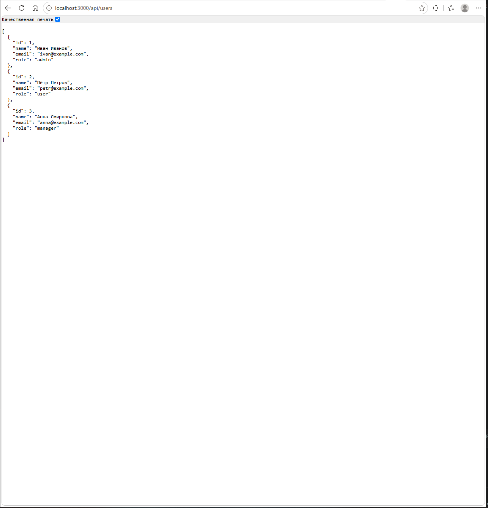
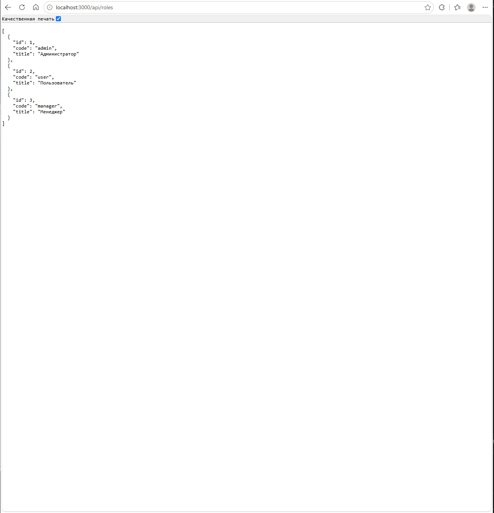
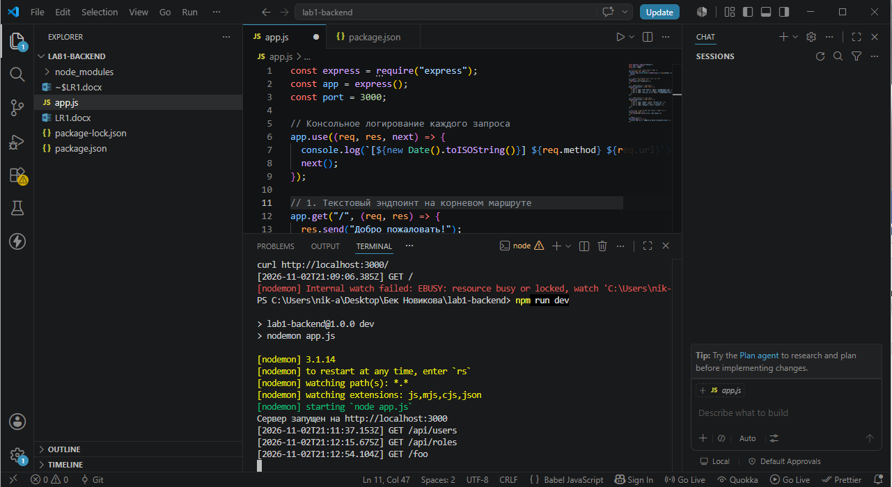

# Лабораторная работа №1: Настройка среды разработки и первый HTTP-сервер

**Студент:** Авдеев Никита Викторович
**Группа:** ПИЖ-б-о-25-2
**Вариант:** 1
**Технология:** Node.js + Express

## Цель работы
Освоить установку инструментов для бэкенд-разработки, создать и запустить
минимальный веб-сервер, обрабатывающий GET-запросы, понять концепцию
эндпоинтов, научиться настраивать автоматический перезапуск сервера.

## Теоретическое обоснование
Эндпоинт (endpoint) - это конкретный адрес (URL) вместе с методом 
HTTP, по которому клиент обращается к серверу для получения ресурса. 
Например: GET /api/users. 
Маршрут (route) - это механизм сопоставления пути запроса с кодом 
обработчика на стороне сервера.
JSON (JavaScript Object Notation) - текстовый формат обмена 
данными, который стал стандартом де-факто для REST API. 

## Выполнение индивидуального задания (Вариант 1)
### Код сервера
```javascript
const express = require("express");
const app = express();
const port = 3000;

// Консольное логирование каждого запроса 
app.use((req, res, next) => {
  console.log(`[${new Date().toISOString()}] ${req.method} ${req.url}`);
  next();
});

// 1. Текстовый эндпоинт на корневом маршруте 
app.get("/", (req, res) => {
  res.send("Добро пожаловать!");
});

// 2. JSON-эндпоинт 1: /api/users
app.get("/api/users", (req, res) => {
  res.json([
    { id: 1, name: "Иван Иванов", email: "ivan@example.com", role: "admin" },
    { id: 2, name: "Пётр Петров", email: "petr@example.com", role: "user" },
    { id: 3, name: "Анна Смирнова", email: "anna@example.com", role: "manager",},
  ]);
});

// 3. JSON-эндпоинт 2: /api/roles
app.get("/api/roles", (req, res) => {
  res.json([
    { id: 1, code: "admin", title: "Администратор" },
    { id: 2, code: "user", title: "Пользователь" },
    { id: 3, code: "manager", title: "Менеджер" },
  ]);
});

// Кастомная обработка 404 (Not Found) с JSON-ответом
app.use((req, res) => {
  res.status(404).json({ error: "Not Found" });
});

// Запуск сервера
app.listen(port, () => {
  console.log(`Сервер запущен на http://localhost:${port}`);
});

### Корневой маршрут


### Список пользователей


### Справочник ролей


### Обработка 404


### Авто-перезапуск и логи


## Ответы на контрольные вопросы

**1. Клиент-серверная архитектура** — модель, где клиент (браузер, приложение) отправляет запрос, а сервер его обрабатывает и возвращает ответ. Клиент не знает внутреннего устройства сервера.

**2. Протокол** — **HTTP** (в защищённом варианте — HTTPS). Работает по схеме «запрос — ответ», не хранит состояние между запросами.

**3. Эндпоинт** — конкретный URL + HTTP-метод, по которому клиент обращается к серверу. Пример: `GET /api/users`. **Маршрут** — механизм сопоставления этого URL с функцией-обработчиком на сервере.

**4. Структура HTTP-запроса/ответа** — стартовая строка (метод, путь, версия / версия, код, пояснение), заголовки, пустая строка, тело. **Код состояния** — трёхзначное число, показывающее результат: 200 OK, 404 Not Found, 500 Internal Server Error и т. д.

**5. JSON** — текстовый формат обмена данными на основе синтаксиса объектов JavaScript. Популярен потому, что читаемый, компактный, языко-независимый и является стандартом де-факто для REST API.

**6. Запуск сервера.**
- Node.js: `npm install express` → `npm run dev` (или `npm start`), сервер слушает `localhost:3000`.
- Flask: `pip install flask` → `python app.py`.

**7. Авто-перезапуск** — сервер сам перезапускается при изменении файлов, чтобы не делать это вручную. Для Node.js используется пакет **nodemon** (`npm install --save-dev nodemon`, скрипт `"dev": "nodemon app.js"`). Во Flask — `debug=True`.

**8. Коды состояния HTTP:** 200 (OK), 201 (Created), 301/302 (редиректы), 400 (Bad Request), 401 (Unauthorized), 403 (Forbidden), **404 (Not Found — ресурс/маршрут не найден)**, 500 (Internal Server Error), 503 (Service Unavailable).

**9. Middleware в Express** — функция между запросом и ответом с доступом к `req`, `res`, `next()`: логирование, авторизация, парсинг тела. Во Flask аналог — декораторы `@app.before_request` / `@app.after_request`.

**10. Параметр из URL-пути.**
- Express: `app.get('/api/users/:id', (req, res) => req.params.id)` — значение строкой.
- Flask: `@app.route('/api/users/<int:user_id>')` — значение сразу приводится к `int`.

## Вывод

В ходе лабораторной работы освоена настройка среды бэкенд-разработки на **Node.js + Express**: установлен Node.js, инициализирован проект, подключены `express` и `nodemon`, создан HTTP-сервер с авто-перезапуском.

В рамках **Варианта 1 (средний уровень)** реализованы текстовый эндпоинт `GET /`, JSON-эндпоинты `GET /api/users` и `GET /api/roles`, кастомная обработка 404 и логирование запросов. Закреплены понятия клиент-серверной архитектуры, HTTP, эндпоинтов, JSON и middleware.

**Трудности:** блокировка `npm.ps1` в PowerShell (решено через `Set-ExecutionPolicy`).

Полученные навыки — основа для следующих работ курса: работа с БД, CRUD, REST API, аутентификация и деплой.

## Список использованых источников 

# Список использованных источников

1. **Node.js — официальная документация.** — URL: https://nodejs.org/en/docs/
2. **Express — официальная документация.** — URL: https://expressjs.com/
3. **HTTP (MDN Web Docs).** — URL: https://developer.mozilla.org/ru/docs/Web/HTTP
4. **JSON (MDN Web Docs).** — URL: https://developer.mozilla.org/ru/docs/Web/JavaScript/Reference/Global_Objects/JSON
5. **Nodemon — документация.** — URL: https://nodemon.io/
6. **Flask — официальная документация.** — URL: https://flask.palletsprojects.com/
7. **REST API — основные принципы (GeeksforGeeks).** — URL: https://www.geeksforgeeks.org/node-js/explain-the-concept-of-restful-apis-in-express/
